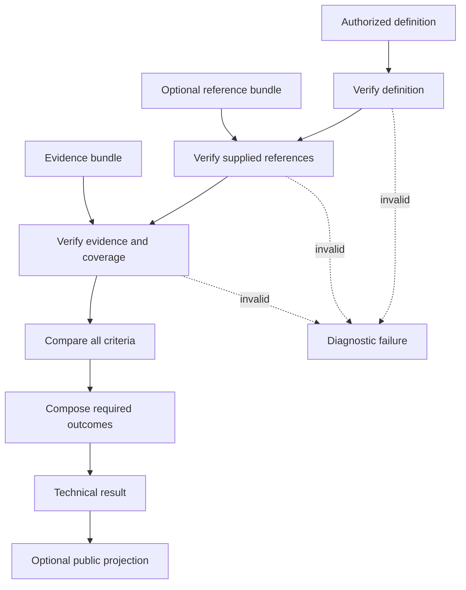
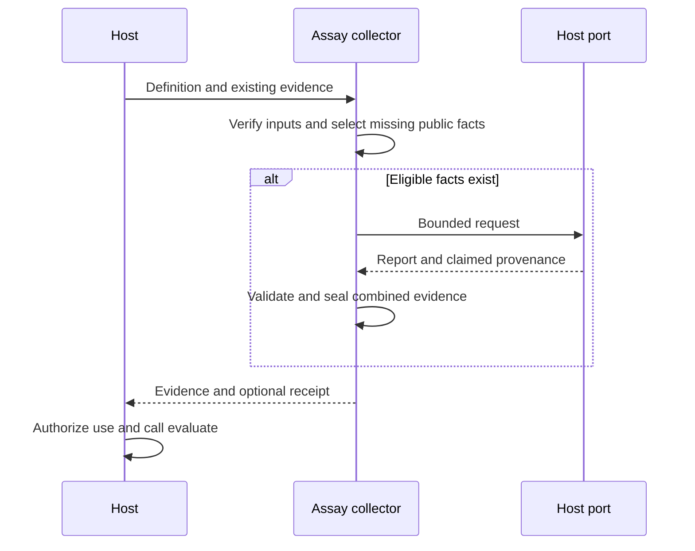

Assay has a synchronous evaluation core and an optional asynchronous collector. The host decides when to call each operation.

## Evaluation

Definition verification happens first, followed by verification of the entire supplied reference bundle and then the evidence. Invalid inputs return diagnostic failures without findings. Valid inputs reach comparators and the required composition engine.

The public projection validates the definition and result correspondence, recomputes the aggregate and emits only permitted fields. It does not receive the evidence, so it cannot authenticate the evaluation.

## Observation acquisition

No port is invoked when no eligible facts are missing. The collector never receives authority to run code by itself; the injected port is host-owned.

## Source modules

| Module | Responsibility |
| --- | --- |
| contracts | Versioned records and public types |
| validation | Bounded snapshots, structural checks and coverage |
| integrity | Canonical JSON and SHA-256 verification |
| evaluation | Comparison and group aggregation |
| observation | Optional fact acquisition |
| projection | Result correspondence and public field selection |

The [release source](https://github.com/0xbuffdev/assay/tree/v0.0.1/src) contains the implementation. See [security and trust](/docs/assay/security) for responsibilities outside the library.
