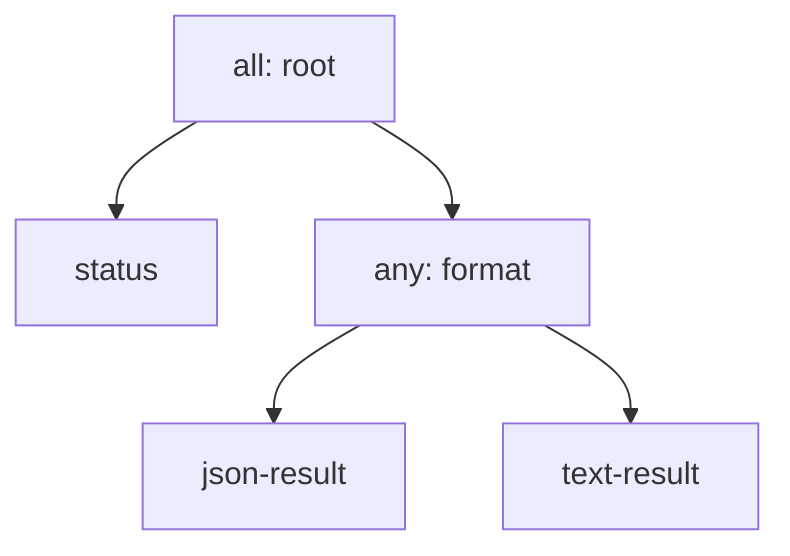

A definition must contain at least one required criterion. The `composed-required-v1` policy combines required findings through a tree of groups. Advisory findings stay outside the tree.

## Require all checks

Use one `all` group for a definition whose required criteria are `output` and `status`.

```ts
composition: {
  rootGroupId: "root",
  groups: [{
    id: "root",
    operator: "all",
    children: [
      { kind: "criterion", id: "output" },
      { kind: "criterion", id: "status" },
    ],
  }],
}
```

## Allow alternatives

Suppose an engineering exercise accepts either a JSON result or a text result, but also requires a status check.





```ts
composition: {
  rootGroupId: "root",
  groups: [
    {
      id: "root",
      operator: "all",
      children: [
        { kind: "criterion", id: "status" },
        { kind: "group", id: "format" },
      ],
    },
    {
      id: "format",
      operator: "any",
      children: [
        { kind: "criterion", id: "json-result" },
        { kind: "criterion", id: "text-result" },
      ],
    },
  ],
}
```

Each ID names a declared required criterion or group. Groups must be reachable from the root, with no cycles or shared subtrees. Each required leaf appears once; advisory leaves cannot appear.

## How groups resolve

Read each row from left to right. The first applicable condition determines the group outcome.

| Operator | First | Then | Then | Otherwise |
| --- | --- | --- | --- | --- |
| all | Any fail: fail | Any error: evaluation_error | Any unresolved: inconclusive | All pass: pass |
| any | Any pass: pass | Any error: evaluation_error | Any unresolved: inconclusive | All fail: fail |

All criteria are validated and evaluated in authored order, even if an alternative already determines the aggregate. Invalid input anywhere rejects the evaluation before comparison. Missing leaves may be acceptable in an alternative whose other leaf passes, but missing evidence never passes on its own.

Group limits are listed in [limits](/docs/assay/limits). Changing composition or authored order changes the definition digest.
