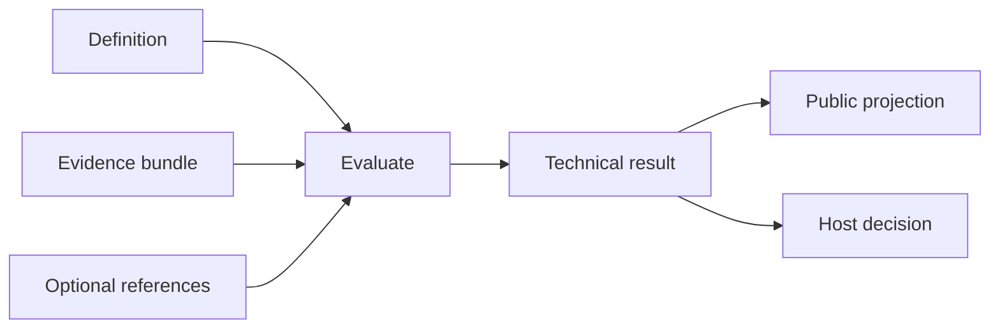

## Records

| Record | Purpose |
| --- | --- |
| Assessment definition | Versioned criteria and the required composition tree. |
| Criterion | One comparison or review requirement, with an ID, mode and visibility. |
| Observation | A typed fact supplied by the host for a criterion. |
| Evidence bundle | Observations sealed to a particular definition, optionally scoped to an artifact. |
| Reference record | A separately stored expected value identified by a digest. |
| Evaluation result | Private technical findings and the composed outcome. |
| Public result | A restricted view derived from a valid definition and result. |

A definition describes what should hold; evidence describes what was observed. Keep these inputs separate. A reference value is an expectation, never an observation.

## Criterion mode and visibility

Required criteria participate in the composition tree. Advisory criteria produce findings without determining the root outcome.

Public criteria may appear in a projected result. Restricted criteria never appear there, and even a restricted advisory criterion causes the public aggregate to be withheld. Restricted objective criteria must refer to protected expected values instead of embedding literals.

## Evidence states

An observation is either `complete` or `truncated`. Missing observations are represented by their absence, not placeholder values. A measured zero, empty string, false or JSON null can be a valid complete observation.

## Evaluation lifecycle

The evaluator returns pass, fail, inconclusive or evaluation error for complete results. Invalid inputs return a separate diagnostic envelope. See [outcomes and reasons](/docs/assay/outcomes) for the distinction.
