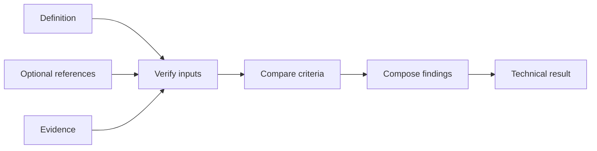
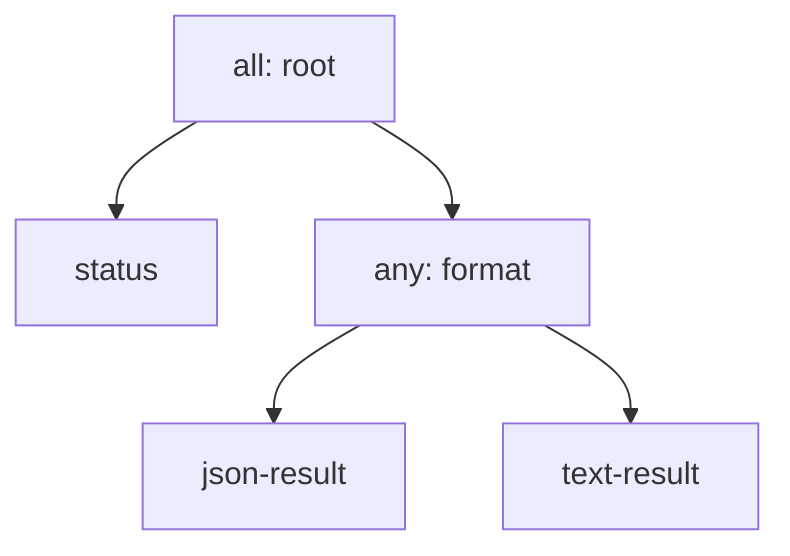

An assessment definition contains criteria and a composition tree. An evidence bundle binds observed values to that definition. The evaluator returns a private technical result. It does not execute programs or award grades.



## Quick start

After [installation](/docs/assay), save this example as `calibration.mjs`. It checks a caller-supplied measurement against an inclusive voltage range.

```js
// assay-docs: runnable
import {
  createAssessmentDefinition,
  createEvidenceBundle,
  evaluate,
  projectPublicResult,
} from "@0xbuff/assay";

const definition = createAssessmentDefinition({
  schemaVersion: 4,
  assessmentId: "calibration",
  revision: "rev1",
  policyVersion: "composed-required-v1",
  criteria: [
    {
      id: "voltage",
      kind: "number_range",
      mode: "required",
      visibility: "public",
      parameters: {
        expected: {
          type: "literal",
          value: { min: 98, max: 102, minInclusive: true, maxInclusive: true },
        },
        unit: "mV",
      },
    },
  ],
  composition: {
    rootGroupId: "root",
    groups: [
      {
        id: "root",
        operator: "all",
        children: [{ kind: "criterion", id: "voltage" }],
      },
    ],
  },
});
if (!definition.ok) throw new Error("Invalid definition");

const evidence = createEvidenceBundle(definition.value, {
  schemaVersion: 4,
  observations: [
    {
      criterionId: "voltage",
      evidenceRef: "measurement",
      kind: "number",
      completeness: "complete",
      value: 101,
      unit: "mV",
    },
  ],
});
if (!evidence.ok) throw new Error("Invalid evidence");

const result = evaluate(definition.value, evidence.value);
const view = projectPublicResult(definition.value, result);
if (!view.ok) throw new Error("Projection rejected");
if (view.value.outcome !== "pass") throw new Error("Expected pass");
console.log(view.value.outcome);
```

Run `node calibration.mjs`. The output is `pass`. Change the observation to 103 and remove the assertion requiring a pass to see `fail`. With no observations, the outcome is `inconclusive`. Changing the unit to V instead of mV rejects the evidence.

## Criteria

Every criterion declares an ID, kind, mode, visibility and parameters. Required criteria participate in composition; advisory findings do not. Public criteria may appear in public projections. Restricted objective criteria must use [protected references](/docs/assay/integrity#protected-references).

| Kind | Observation | Parameters |
| --- | --- | --- |
| exact_text | text | expected |
| normalized_text | text | expected, normalization |
| number_with_tolerance | number | expected, tolerance, optional unit |
| number_range | number | expected, optional unit |
| set_equivalence | set | expected, itemType, order, duplicates |
| boolean_equality | boolean | expected |
| json_equality | json | expected |
| observed_execution | execution | assertions |
| manual_evidence | manual | review: required |
| qualitative_review | qualitative_review | reviewPolicyId, reviewPolicyVersion |

The first seven kinds compare a literal or content-bound reference expectation. The remaining kinds produce unresolved findings.

### Text

Exact comparison uses UTF-16 code-unit equality. Normalized text applies the declared transformations to both values, in this order: line endings (`preserve` or `lf`), case (`sensitive` or `fold`), Unicode (`none`, `NFC` or `NFKC`), whitespace (`preserve` or `collapse`) and trim (`none` or `both`). Case folding uses JavaScript lowercase conversion, not full Unicode case folding.

### Numbers

Tolerance is inclusive: the absolute difference must not exceed the greater of the absolute tolerance and the relative tolerance multiplied by the magnitude of the expected value.

```ts
parameters: {
  expected: { type: "literal", value: 100 },
  tolerance: { absolute: 2, relative: 0.05 },
  unit: "mV",
}
```

A value of 105 passes; 106 fails. Both tolerances are finite and nonnegative. Numeric ranges specify finite min/max and both inclusion flags; equal endpoints require both flags to be true. Observations must use exactly the declared unit, including its absence. No string coercion or unit conversion occurs. A nonfinite relative bound produces `NUMERIC_OVERFLOW`.

### Sets, booleans and JSON

Sets use `itemType` of string, number or boolean. The observation field is `items`. With order ignored and duplicates ignored, compare membership; respecting duplicates compares counts. With order preserved, compare sequences, removing repeated items only when duplicates are ignored.

Boolean equality is strict. JSON equality ignores object key order but preserves array order; strings and keys are exact. Negative zero equals zero. False and null are legitimate values.

## Composition

Every required criterion belongs exactly once to a nonempty tree under the policy `composed-required-v1`. Use an `all` group for conjunction and an `any` group for alternatives.

```ts
composition: {
  rootGroupId: "root",
  groups: [
    {
      id: "root",
      operator: "all",
      children: [
        { kind: "criterion", id: "status" },
        { kind: "group", id: "format" },
      ],
    },
    {
      id: "format",
      operator: "any",
      children: [
        { kind: "criterion", id: "json-result" },
        { kind: "criterion", id: "text-result" },
      ],
    },
  ],
}
```



IDs are unique across groups and criteria. Groups must be reachable from the root without cycles or shared subtrees. Advisory criteria cannot appear in composition.

| Operator | First condition | Otherwise | Otherwise | Otherwise |
| --- | --- | --- | --- | --- |
| all | Any fail: fail | Any error: evaluation_error | Any unresolved: inconclusive | All pass: pass |
| any | Any pass: pass | Any error: evaluation_error | Any unresolved: inconclusive | All fail: fail |

Every criterion is validated and compared in authored order, even when an alternative is decisive. Invalid input rejects evaluation before comparison.

## Evidence

Use `createEvidenceBundle(definition, draft)` to seal observations. The draft has schemaVersion, observations and optional artifactDigest; Assay derives the definition lineage and evidence digest.

Each observation has a criterion ID, unique evidence reference, kind and completeness. Omit unavailable facts and mark partial captures `truncated`. Do not fabricate placeholder values. `inspectEvidenceCoverage` lists missing and incomplete required leaves without determining the aggregate.

An artifact-scoped bundle requires an origin on each observation. Artifact origins carry the exact bundle artifact digest and source reference. Independent origins carry no artifact digest. Unscoped observations may omit origin but cannot claim artifact scope. Selected execution facts additionally require run reference and termination. Correcting an observation requires sealing a new bundle.

## Outcomes

Complete results return pass, fail, inconclusive or evaluation_error, with one finding per criterion. Invalid inputs return only diagnostics, as invalid_definition, invalid_reference or invalid_evidence. Advisory warnings do not change the aggregate.

Keep full results private and use [public projection](/docs/assay/integrity#public-projection) for authorized disclosure. See [contracts and errors](/docs/assay/contracts) for exact records, codes and resource limits.
