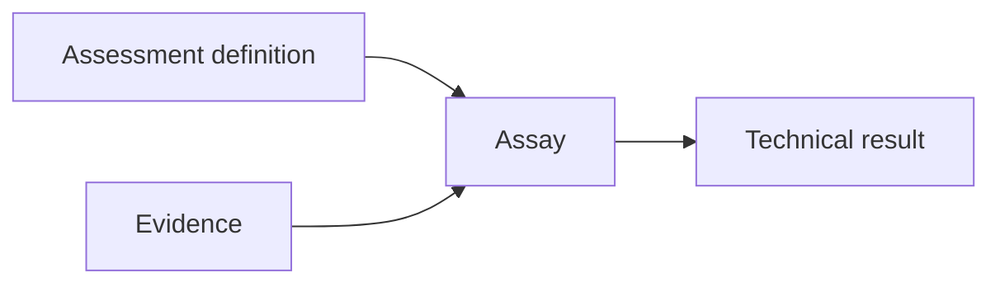

Assay evaluates technical evidence against criteria you define. It returns reproducible findings that describe whether observed results match your expectations.

Use Assay to check program output, verify measurements, compare structured data or build assessment systems. It runs offline and has no runtime dependencies.

## How it works

An assessment definition specifies the expected results and how required checks are combined. Evidence contains the observed values. Assay validates the records, compares the values and returns a finding for each criterion and an overall technical outcome.

## Capabilities

- Compare text, numbers, sets, booleans and JSON.
- Combine required criteria using all or any groups.
- Evaluate captured execution facts and collect observations through a host-supplied adapter.
- Record advisory human or model reviews.
- Protect expected values, verify content digests and project public results.

Your application supplies evidence, authorizes criteria and decides how to use the findings. Assay does not execute submitted programs, authenticate observations, assign grades or issue credentials.

## Get started

Follow [Getting started](/docs/assay/getting-started) to install Assay and run your first evaluation.

[Source](https://github.com/0xbuffdev/assay) · [Changelog](https://github.com/0xbuffdev/assay/blob/main/CHANGELOG.md) · [License](https://github.com/0xbuffdev/assay/blob/main/LICENSE)
