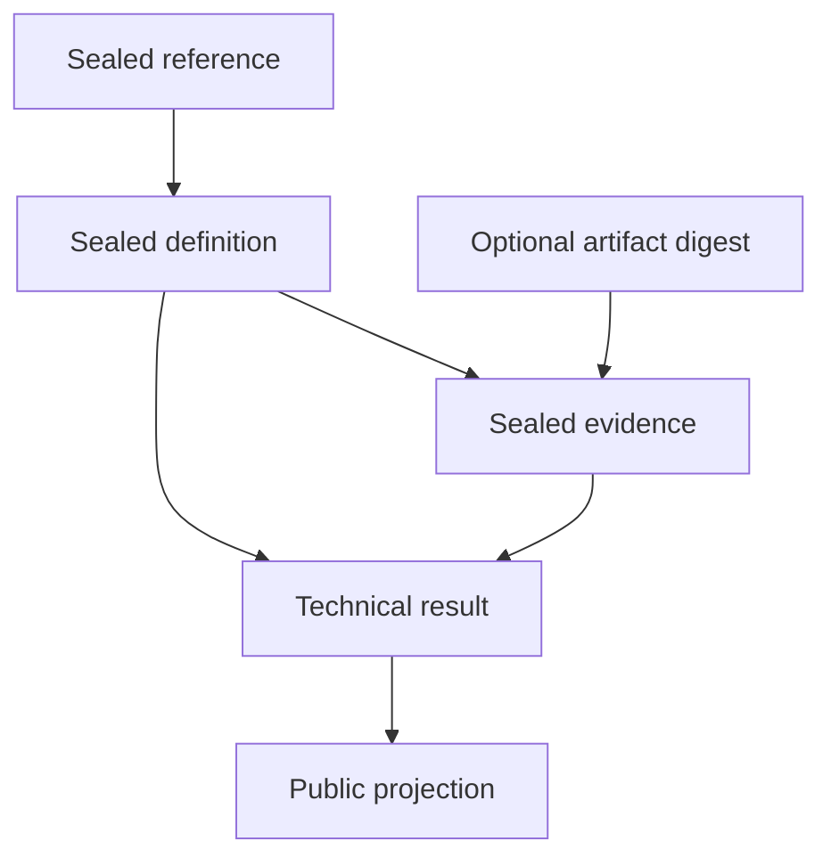
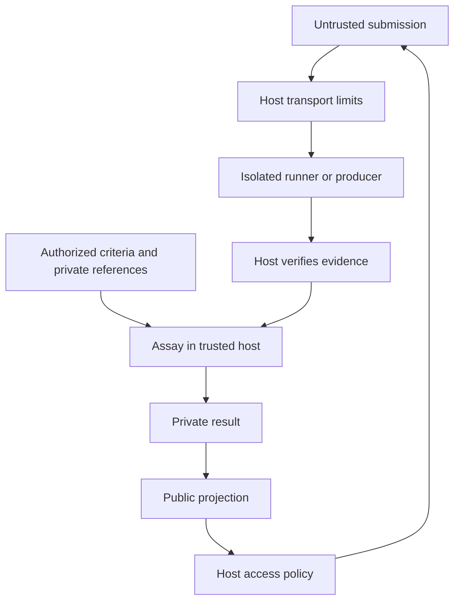

Assay validates and hashes content. Your application authenticates publishers and producers, authorizes inputs, isolates execution and decides who can receive findings. A valid digest cannot establish identity or authority.

## Content integrity

Definitions, references and evidence use separate schema-4 canonical domains.

| Record | Domain | Digest field | Create / verify |
| --- | --- | --- | --- |
| Definition | assay:definition:v4 | revisionDigest | createAssessmentDefinition / verifyAssessmentDefinition |
| Reference | assay:reference:v4 | referenceDigest | createReferenceRecord / verifyReferenceBundle |
| Evidence | assay:evidence:v4 | evidenceDigest | createEvidenceBundle / verifyEvidenceBundle |

The creators validate unsigned drafts and derive digests; `computeDefinitionDigest` computes a definition digest separately. Canonical JSON sorts object keys by UTF-16 code-unit order, preserves array order and absent optional fields, omits only the record's own digest and serializes negative zero as zero. Hash the UTF-8 bytes of the domain, one LF and compact JSON (no trailing LF) with SHA-256. The digest is lowercase hexadecimal prefixed by `sha256:`.



The definition binds authored criteria and composition. Evidence binds lineage, observations and origin claims. A changed definition requires a new revision; corrected evidence requires a new bundle. Older schemas are rejected. See the [canonical vectors](https://github.com/0xbuffdev/assay/blob/v0.0.1/docs/integrity.md).

## Protected references

Restricted objective criteria cannot embed literal expectations. Seal the reference separately and bind its ID and digest into the definition.

```js
// assay-docs: runnable
import {
  createReferenceRecord,
  createAssessmentDefinition,
  createEvidenceBundle,
  evaluate,
  projectPublicResult,
} from "@0xbuff/assay";

const reference = createReferenceRecord({
  schemaVersion: 4,
  referenceId: "expected-output",
  kind: "text",
  value: "ok",
});
if (!reference.ok) throw new Error("Invalid reference");

const created = createAssessmentDefinition({
  schemaVersion: 4,
  assessmentId: "protected-check",
  revision: "rev1",
  policyVersion: "composed-required-v1",
  criteria: [{
    id: "output",
    kind: "exact_text",
    mode: "required",
    visibility: "restricted",
    parameters: {
      expected: {
        type: "reference",
        referenceId: reference.value.referenceId,
        referenceDigest: reference.value.referenceDigest,
      },
    },
  }],
  composition: {
    rootGroupId: "root",
    groups: [{
      id: "root",
      operator: "all",
      children: [{ kind: "criterion", id: "output" }],
    }],
  },
});
if (!created.ok) throw new Error("Invalid definition");

const definition = created.value;
const references = {
  schemaVersion: 4,
  definition: {
    assessmentId: definition.assessmentId,
    revision: definition.revision,
    revisionDigest: definition.revisionDigest,
  },
  references: [reference.value],
};

const prepared = createEvidenceBundle(definition, {
  schemaVersion: 4,
  observations: [{
    criterionId: "output",
    evidenceRef: "capture-1",
    kind: "text",
    completeness: "complete",
    value: "ok",
  }],
});
if (!prepared.ok) throw new Error("Invalid evidence");

const result = evaluate(definition, prepared.value, references);
const projected = projectPublicResult(definition, result);
if (result.outcome !== "pass" || !projected.ok ||
    projected.value.outcome !== "withheld") {
  throw new Error("Unexpected outcome");
}
console.log(result.outcome, projected.value.outcome);
```

Expected output in the trusted development terminal: `pass withheld`. Never expose the private outcome or protected reference to a submitting user.

A supplied reference bundle must match the exact assessment ID, revision and revision digest. Each record must match its declared ID, kind, digest, numeric unit or set item type. Unknown, duplicate, malformed or substituted supplied references return invalid_reference before evidence comparison. A missing reference is inconclusive when needed. A hash of a low-entropy secret can be guessed; a digest is not encryption.

## Public projection

`projectPublicResult(definition, result)` checks definition integrity, exact lineage, finding correspondence and order, reason compatibility, aggregate and warning consistency. The projected record contains schemaVersion, outcome and public findings with only criterionId, outcome and reason.

If any criterion is restricted, even an advisory one, the aggregate is always `withheld` and restricted findings are omitted. Rejection uses the opaque code `PUBLIC_PROJECTION_REJECTED`. The function does not receive evidence and cannot authenticate a purported result; use results produced in your trusted host and independently authorize the recipient.

## Host responsibilities



Keep private expectations, definitions, evidence and full results away from submitted programs, public endpoints, prompts and user-accessible logs. Verify the actual artifact, runner and reviewer provenance. Assay does not assign grades or issue credentials.

Cap transport bytes before buffering; use `decodeSerializedRecord` before contract validation to reject duplicate keys and malformed JSON. Do not accept adversarial live Proxy objects as inert data. Escape captured text and review feedback before rendering. Rate-limit repeated submissions and avoid timing or secondary feedback channels that expose protected outcomes. If the existence of restricted checks is itself sensitive, use a host-defined fixed response envelope.

Report vulnerabilities through the [security policy](https://github.com/0xbuffdev/assay/blob/v0.0.1/SECURITY.md).
