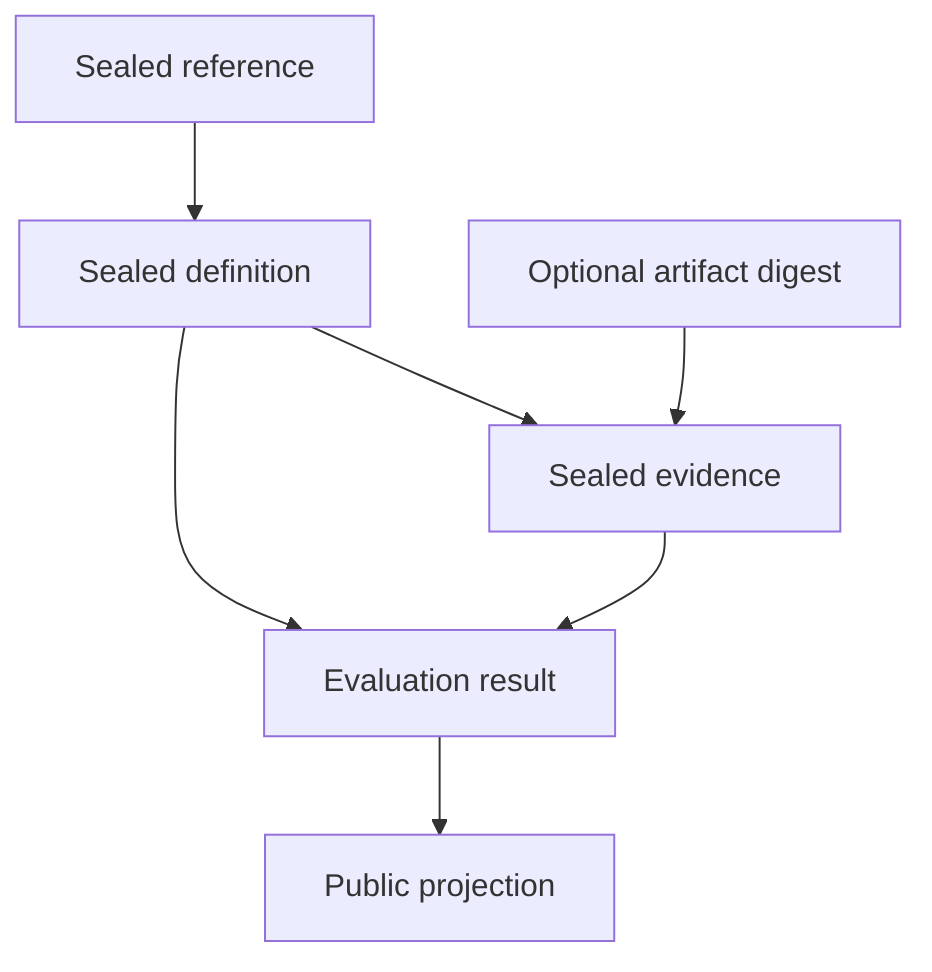

Assay seals definitions, references and evidence using SHA-256 over canonical JSON. Digests identify content; they do not identify or authenticate its publisher.

## Seal and verify records

| Record | Create | Verify |
| --- | --- | --- |
| Definition | createAssessmentDefinition | verifyAssessmentDefinition |
| Reference | createReferenceRecord | verifyReferenceBundle |
| Evidence | createEvidenceBundle | verifyEvidenceBundle |

`computeDefinitionDigest(draft)` computes the definition digest without creating a sealed record. The creation helpers validate unsigned drafts and derive digests. Do not supply digest fields in drafts.

## Canonical profile

Schema 4 uses separate domains:

| Record | Domain | Omitted field |
| --- | --- | --- |
| Definition | assay:definition:v4 | revisionDigest |
| Reference | assay:reference:v4 | referenceDigest |
| Evidence | assay:evidence:v4 | evidenceDigest |

After closed-contract validation, Assay sorts object keys by ECMAScript UTF-16 code-unit order and serializes compact JSON. Array order is retained, strings are not normalized, optional absent fields remain absent and negative zero serializes as zero. The UTF-8 bytes are the domain, one LF, then canonical JSON with no trailing LF. Hash the bytes using SHA-256 and prefix lowercase hexadecimal with `sha256:`.

The [release integrity vectors](https://github.com/0xbuffdev/assay/blob/v0.0.1/docs/integrity.md) provide independent test inputs and expected digests.

## Preserve lineage

A definition binds its criteria and composition, including authored order. Evidence binds the exact definition identity, optional artifact digest, observations and origin claims. The result carries definition and evidence lineage, policy and evaluator identity.

A changed definition requires a new immutable revision. Corrected observations require a new evidence bundle. Older schemas are rejected; do not rehash old records as schema 4.

## Trust boundary

A caller can compute a valid digest for fabricated data. Authenticate the publisher and evidence producer independently, and authorize the exact definition and protected reference bundle before evaluation. Never treat a digest as a signature or as encryption.
