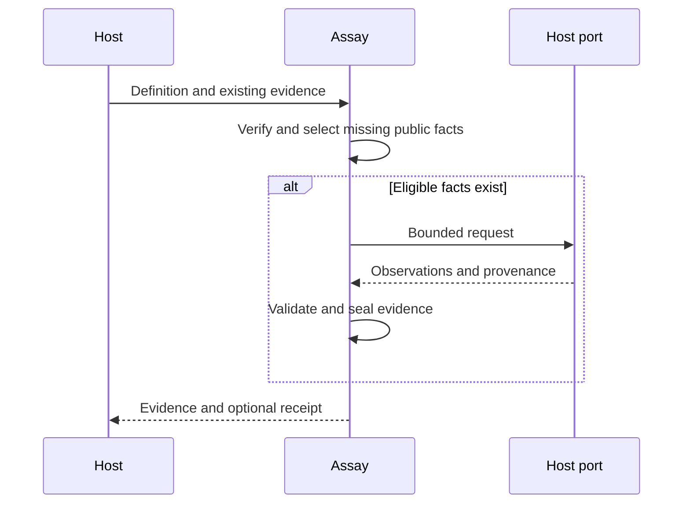

Assay consumes observations supplied by your application. It does not install a runner, connect to an AI provider or verify the authenticity of a capture.

## Execution facts

Declare `executionFact` on both the objective criterion and its observation.

| Selector | Criterion kinds | Observation kind |
| --- | --- | --- |
| stdout, stderr | exact_text, normalized_text | text |
| exit_status | number_with_tolerance, number_range | number |
| boolean_property | boolean_equality | boolean |
| structured_stdout, structured_stderr | json_equality | json |

Exit status is a signed safe integer without a unit. Boolean properties are identified by criterion ID. Structured stream values are host-supplied JSON.

This example uses a fixture in place of an isolated runner.

```js
// assay-docs: runnable
import { createAssessmentDefinition, createEvidenceBundle, evaluate } from "@0xbuff/assay";

const created = createAssessmentDefinition({
  schemaVersion: 4,
  assessmentId: "command-output",
  revision: "rev1",
  policyVersion: "composed-required-v1",
  criteria: [{
    id: "output",
    kind: "exact_text",
    executionFact: "stdout",
    mode: "required",
    visibility: "public",
    parameters: { expected: { type: "literal", value: "ok" } },
  }],
  composition: {
    rootGroupId: "root",
    groups: [{
      id: "root",
      operator: "all",
      children: [{ kind: "criterion", id: "output" }],
    }],
  },
});
if (!created.ok) throw new Error("Invalid definition");

const prepared = createEvidenceBundle(created.value, {
  schemaVersion: 4,
  observations: [{
    criterionId: "output",
    evidenceRef: "stdout-1",
    kind: "text",
    executionFact: "stdout",
    completeness: "complete",
    value: "ok",
    origin: {
      kind: "independent",
      sourceRef: "fixture",
      runRef: "run-1",
      termination: "exited",
    },
  }],
});
if (!prepared.ok) throw new Error("Invalid evidence");

const result = evaluate(created.value, prepared.value);
if (result.outcome !== "pass") throw new Error("Expected pass");
console.log(result.outcome);
```

A timeout or crash makes selected facts inconclusive. Truncation takes precedence with `EVIDENCE_TRUNCATED`. Complete observations of the same selected stream or exit status must agree for the same source and run. Known truncation invalidates contradictory complete claims; stdout and stderr are tracked separately. Exit status is independent of capture truncation. The assertion-only `observed_execution` kind cannot establish correctness even when reported as confirmed.

## Observation ports

Use `collectObservations` to request missing public objective or execution facts through a host-owned async port. Evaluation itself remains synchronous.



Implement `observe(request, signal?)`. The following mock returns a local fixture and requires no external service.

```js
// assay-docs: runnable
import {
  collectObservations,
  createAssessmentDefinition,
  createEvidenceBundle,
  evaluate,
} from "@0xbuff/assay";

const created = createAssessmentDefinition({
  schemaVersion: 4,
  assessmentId: "public-demo",
  revision: "rev1",
  policyVersion: "composed-required-v1",
  composition: {
    rootGroupId: "root",
    groups: [{ id: "root", operator: "all", children: [{ kind: "criterion", id: "stdout" }] }],
  },
  criteria: [
    {
      id: "stdout",
      kind: "exact_text",
      mode: "required",
      visibility: "public",
      parameters: { expected: { type: "literal", value: "ok" } },
    },
  ],
});
if (!created.ok) throw new Error("Invalid authored definition");
const definition = created.value;

const prepared = createEvidenceBundle(definition, {
  schemaVersion: 4,
  observations: [],
});
if (!prepared.ok) throw new Error("Invalid evidence");
const startingEvidence = prepared.value;

const mockPort = {
  async observe(request) {
    // request lists only public IDs, expected fact kinds and resource limits.
    return {
      schemaVersion: 4,
      definition: request.definition,
      provenance: {
        adapterId: "fixture",
        adapterVersion: "v1",
        runRef: "local-run",
        toolchainId: "node",
        toolchainVersion: "v24",
        capturedStdoutBytes: 2,
        capturedStderrBytes: 0,
        stdoutTruncated: false,
        stderrTruncated: false,
      },
      observations: [
        {
          criterionId: "stdout",
          evidenceRef: "stdout1",
          kind: "text",
          completeness: "complete",
          value: "ok",
        },
      ],
    };
  },
};

const collected = await collectObservations(definition, startingEvidence, mockPort);

if (!collected.ok) throw new Error("Collection failed");
const result = evaluate(definition, collected.evidence);
if (result.outcome !== "pass") throw new Error("Expected pass");
console.log(result.outcome);
```

The request includes definition lineage, optional artifact scope, eligible public criterion IDs, kinds, applicable units/item types/selectors/assertion IDs, and capture limits. It excludes expected values, protected reference IDs, restricted criteria and commands.

The report echoes the definition and scope and supplies provenance: adapter and toolchain IDs and versions, run reference, captured byte counts and truncation flags. Combined stdout/stderr capture is limited to 65,536 bytes. Report observations must not carry their own origin. Selected facts require top-level termination. The collector adds the report's origin to new observations and seals the combined evidence. Existing observations remain unchanged.

| Response | Meaning |
| --- | --- |
| ok: true | Sealed evidence and receipt; null receipt if no port ran |
| invalid_definition | Invalid definition |
| invalid_evidence | Invalid evidence, report or merged lineage |
| OBSERVATION_PORT_ERROR | Port threw or rejected |
| OBSERVATION_CANCELLED | Host cancelled acquisition |

Pass an optional `{ signal: controller.signal }` as the fourth argument. A valid pre-aborted call does not invoke the port; cancellation ignores late completion. The host must stop any actual running process. No default timeout or retry is applied.

## Qualitative reviews

Use an advisory-only criterion outside the composition tree to record human or model feedback. Required manual evidence remains pending authorized review.

```ts
{
  id: "readability",
  kind: "qualitative_review",
  mode: "advisory",
  visibility: "public",
  parameters: {
    reviewPolicyId: "code-review",
    reviewPolicyVersion: "v1",
  },
}
```

The review observation must bind to the bundle's artifact digest and match the policy.

```ts
{
  criterionId: "readability",
  evidenceRef: "review-1",
  kind: "qualitative_review",
  completeness: "complete",
  origin: {
    kind: "artifact",
    artifactDigest,
    sourceRef: "review-service",
  },
  reviewPolicyId: "code-review",
  reviewPolicyVersion: "v1",
  reviewer: {
    kind: "human",
    reviewerId: "reviewer-1",
    reviewerVersion: "v1",
  },
  uncertainty: "low",
  feedback: "Name the intermediate result before returning it.",
  citations: [{ artifactRef: "solution", startByte: 0, endByte: 10 }],
}
```

Choose the reviewer field for the source of the feedback:

```ts tab="Human"
reviewer: {
  kind: "human",
  reviewerId: "reviewer-1",
  reviewerVersion: "v1",
}
```

```ts tab="Model"
reviewer: {
  kind: "model",
  providerId: "provider",
  modelId: "review-model",
  modelVersion: "v1",
  promptId: "code-review",
  promptVersion: "v1",
}
```

The host computes the artifact digest, obtains feedback and verifies attribution and citation locations. Citations use nonnegative safe integer byte offsets with exclusive ends. Feedback is nonempty inert text, limited to 4,096 UTF-8 bytes and UTF-16 code units; supply one to eight distinct citations. Uncertainty is low, medium, high or unknown. Version IDs cannot be latest.

Missing, truncated and complete reviews remain inconclusive, using EVIDENCE_MISSING, EVIDENCE_TRUNCATED and REVIEW_REQUIRED respectively. The collector does not request or accept qualitative reviews. Review text, attribution, uncertainty and citations stay in privileged evidence; public projection omits them.
