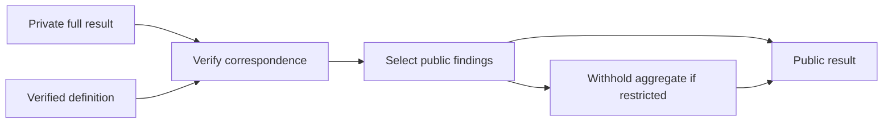

Treat full evaluation results as private records. They contain criterion IDs, evidence references, reasons and an aggregate that can depend on protected checks.

## Project a result

After creating a verified definition and evaluating authorized evidence, call:

```ts
const projected = projectPublicResult(definition, result);
if (!projected.ok) {
  throw new Error("Public projection rejected");
}
// Authorize the requesting user before returning projected.value.
```

This fragment assumes the API was imported and the records were created by the trusted host.

A public result contains `schemaVersion`, `outcome` and `findings`. Each finding contains only the public criterion ID, its outcome and a finite public reason.


```json
{
  "schemaVersion": 4,
  "outcome": "pass",
  "findings": [
    { "criterionId": "voltage", "outcome": "pass", "reason": "match" }
  ]
}
```

## Restricted criteria

If any criterion is restricted, including an advisory criterion, the aggregate is always `withheld`. Restricted findings are omitted entirely. The projection does not disclose their count, values, evidence references or outcomes.




## Rejection and authorization

Projection rejects invalid definitions, invalid-input envelopes and inconsistent results with one opaque reason: `PUBLIC_PROJECTION_REJECTED`. It checks lineage, finding order, reason compatibility and recomputed composition and warning coherence.

The function does not receive evidence, so it cannot authenticate the origin of a purported result. Only project results produced or verified in your trusted environment, and independently authorize the recipient. Repeated submissions, timing and other host feedback can leak information; keep those channels under host control.

See [public reason codes](/docs/assay/outcomes) and [security and trust](/docs/assay/security).
