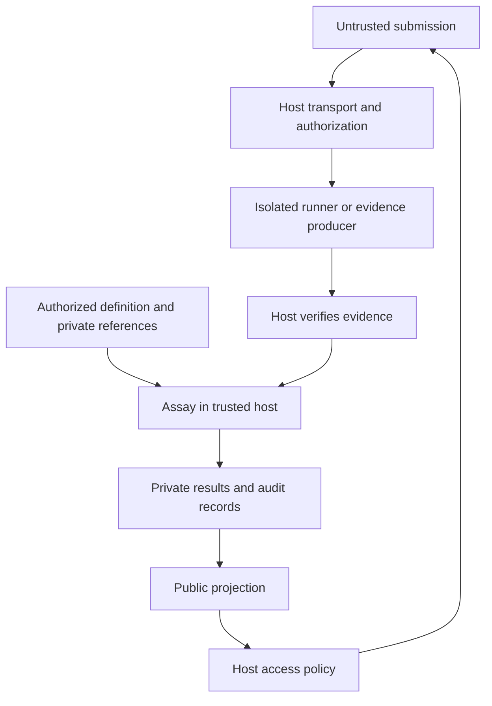

Assay performs bounded validation and technical comparison. Your application establishes authority over inputs, execution and disclosure.

## Responsibilities

| Assay | Host application |
| --- | --- |
| Validate closed record shapes and recompute content digests | Authenticate publishers, authorize definitions and verify artifact identity |
| Compare values and compose required outcomes | Run submitted code in an isolated environment and capture facts accurately |
| Validate adapter reports and provenance claims | Verify actual runner identity and provenance |
| Map findings to public fields | Authenticate recipients, enforce access policy and control repeated feedback |
| Record attributed qualitative review | Verify attribution, citations and any formal review decision |

A technical pass does not award academic credit or a credential.

## Place the trust boundary

Keep private expectations, full definitions and results away from the submitted program, public endpoints, prompts and user-accessible logs. Do not send protected references to a port. A valid digest proves content identity, not authenticity.

## Accept untrusted input

Enforce transport byte limits before buffering. Decode serialized JSON with `decodeSerializedRecord` before contract validation; it rejects duplicate keys and bounded-input violations. Prefer serialized records at trust boundaries. Do not pass adversarial live JavaScript Proxy objects: JavaScript cannot reliably inspect them without invoking traps.

Validate and verify records in the trusted host. Treat diagnostics as private operational data even though they avoid raw values. Escape any captured text or feedback when rendering it.

## Return findings

Use [public projection](/docs/assay/public-results), then authorize disclosure. If even the existence of restricted checks must remain secret, design a fixed host response envelope rather than revealing the projection's withheld state. Limit repeated submissions and avoid timing or secondary-feedback channels that reveal private outcomes.

Report security issues using the [security policy](https://github.com/0xbuffdev/assay/blob/v0.0.1/SECURITY.md). Do not publish private evidence or credentials in issue reports.
